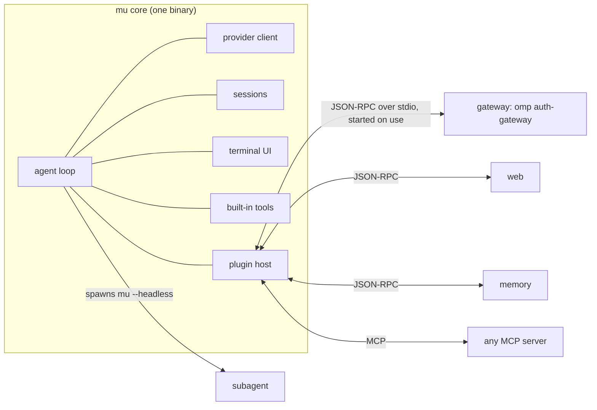

# mu — design

A terminal coding agent with pi's pluggability and omp's capabilities, where the memory it holds is the
user's content plus what the user is using right now. A Rust core does the agent work; every other
feature is a plugin that loads on use.

Status: early and experimental, changing quickly; no stable version (see README, Status). All decisions so far are recorded in place.

## Principles

1. **Resident memory = content + active capability.** Content (conversation, tool output, images) may use
   whatever it needs. Anything incidental — runtimes, eager initialization, idle processes, caches nobody
   reads, allocator retention — must go to zero.
2. **Load on use.** Nothing starts, parses or allocates until the user or the model needs it.
3. **omp-compatible files.** Context files, skills, rules, MCP config and sessions work unchanged.
4. **Reuse before rewrite.** omp's MIT-licensed Rust crates for tools; omp's own gateway for OAuth and other providers; native clients only for API keys and the ChatGPT sign-in.

## Why

Measured 2026-10-23 on this machine (method in the appendix), except the mu row (2026-11-06). [`BENCHMARKS.md`](BENCHMARKS.md) has the current comparison on a scripted task.

| Agent | Private RAM per idle session | Notes |
|---|---|---|
| omp 18.12.6 | 165 MB (133 MB with extensions, LSP, skills, rules off) | Disabled features stay resident; plus machine-wide helpers of 97 + 23 + 23 MB |
| pi 1.4.0 | 72 MB | Node runtime floor |
| Codex CLI (Rust) | 27 MB | 308 MB binary; everything bundled |
| mu | 3.6 MB (20 MB total with the binary's shared pages) | Without its gateway pair, which is shared by all sessions and only needed for providers without an API key in mu: 216 MB private, 306 MB total idle |
| Rust floor (HTTPS + TLS + async runtime) | 0.6 MB | 6.2 MB binary |

## Architecture



## Core

| Component | Responsibility | Reuse |
|---|---|---|
| Agent loop | Turns, tool execution, model roles, thinking levels, compaction, plan mode. Within one assistant message, consecutive read-only calls that need no approval (`Permissions::runs_concurrently` plus an `Allow` verdict) run concurrently on the loop's thread, at most 8 at a time; every other call is a barrier that runs alone. Hooks and start events run call by call in message order, results are appended in call order | — |
| Provider client | Streaming requests, retries, thinking mapping and usage, over three wire formats (Anthropic Messages, OpenAI Responses, Chat Completions) to a provider's own API with the user's key or ChatGPT sign-in, or Anthropic Messages to the omp gateway | — |
| Sessions | omp v3 JSONL tree (`id`/`parentId`), resume; a running `-p` run can be stopped at a tool boundary and taken over (`mu take`); owners are recorded in `<profile home>/run/` (pid, kind, agent, cwd, parent; the jobs panel's Sessions tab lists the live ones); a per-session inbox in `<profile home>/inbox/<id>/` that `mu notify` fills and an interactive owner drains (`SIGUSR2` wakes it); the file format is unchanged. Branching (`/fork`) and checkpoint/rewind (`/rewind`) are implemented | — |
| Context | AGENTS.md / CLAUDE.md discovery, skills, `RULES.md`, prompt templates, slash commands | — |
| Stream rules | Regex rules checked against the model stream; on match: abort, inject the rule, retry | — |
| Built-in tools | read, write, edit (hash-anchored), bash, grep, glob, todo, ask | `pi-edit`, `pi-shell`, `pi-walker`, `pi-diff`, `pi-vcs` |
| Output spill | Tool output above a threshold goes to `artifact://` files, not the heap. Images are stored once as content-addressed blob files (`<profile home>/blobs/<sha256>`) and messages keep only omp's `blob:sha256:<hash>` reference; the bytes are read back when a request is built. mu also reads blobs from omp's own store, so omp sessions with images load; omp does not read mu's store | — |
| Subagents | Spawn `mu --headless` with a task; receive a schema-validated result. A `task` item may carry `outputSchema` (omp's name); the child then gets omp's `yield` tool (`{data}` or `{error}`; `data` is checked against the schema and a mismatch comes back as a tool error to retry). The `result` NDJSON line gains `data` and `schemaOk`; `text` and `isError` stay. A schema task with no valid `yield` fails (one nudge turn first). Validation is a small in-tree validator (no `$ref`), not a crate. | — |
| Plugin host | Manifests, lazy start, lifetimes, hooks, MCP client | — |
| Terminal UI | Inline rendering into the terminal's scrollback; streaming markdown, diffs, status line | — |

Stream rules stay in the core because they run on every streamed token; a process hop there buys nothing.

## Crates and layers

The core is a workspace of crates. Each depends only on the ones above it in this table, and the compiler rejects a cycle; a new edge is a `Cargo.toml` change that shows up in review. `mu-common` is shared with the plugins; `mu-testutil` is a dev-dependency, and an optional dependency of `mu-agent` and `mu-provider` behind their `test-support` feature, which only test builds enable.

| Crate | Holds | Depends on |
|---|---|---|
| `mu-common` | paths, fs, rpc, time | — |
| `mu-base` | protocol and foundation: messages, the agent event protocol, the tool contract (`tool`), text helpers, process and pty handling, `jsoncache`, schema validation, secrets redaction, config, model types and roles, git, `mem` | mu-common |
| `mu-provider` | provider client and wire formats, model catalog, discovery and pricing, the API-key store, the ChatGPT sign-in (`auth/chatgpt`), the gateway source and quota | mu-base |
| `mu-session` | session files, tail reader, the notify inbox and sender, run control (stop, terminate, live-run check) | mu-base |
| `mu-tools` | built-in tools (`tools/`, with the shell), background jobs, the plugin host, the MCP data layer, context discovery | mu-base, mu-provider, mu-session |
| `mu-agent` | the agent loop, compaction, the system prompt, plans, review core, `AgentHandle` and `build_agent` | mu-base, mu-provider, mu-session, mu-tools |
| `mu-tui` | the terminal UI, themes, tree-sitter syntax highlighting | mu-base, mu-provider, mu-session, mu-tools |
| `mu` (root) | `main.rs`, `cli/`, `run/` (modes, setup, signals, headless, ACP), `workflow/` (deliver, plan and review commands, notify, take), `update.rs` | everything |

The tools-to-provider edge exists because the plugin host serves `core/complete` through the provider client. Nothing depends on `mu-tui` or `mu`. Test-only hooks sit behind a `test-support` feature of the crate that owns them, enabled from `[dev-dependencies]` so release builds never contain them.

### Errors

Inside a crate, errors are `anyhow`. Where a caller branches on the kind (a session lookup that is ambiguous, a stop request that found the run gone, a missing model), the function returns a typed enum with a `Display` impl, and callers match on the variant, never on message text. `String` is for display and RPC boundaries only: a tool result, a status line, a JSON-RPC message. A JSON-RPC error that a peer may branch on carries a machine-readable `kind` next to its `message` (`mu_common::rpc::kind`; today only `no_model`).

## Plugins

### Protocol

- **Transport:** JSON-RPC 2.0, newline-delimited over stdio — MCP's stdio framing. An MCP server is a plugin
  that only provides tools.
- **Manifest:** each plugin ships a static `plugin.toml`. The core reads manifests at startup (small files)
  and advertises their tools to the model **without starting the plugin process**.

  ```toml
  name = "web"
  command = ["mu-web"]
  lifetime = "idle:10m"           # session | idle:<duration> | call
  hooks = []                      # e.g. ["tool_result:write"]
  required_hooks = []             # subset of hooks; see Hooks
  timeout = "300s"                # native tool calls; default 300s

  [[tools]]
  name = "fetch"
  description = "Fetch a URL and return it as markdown"
  schema = "schemas/fetch.json"
  tier = "read"                   # read | exec (default): a read tool needs no approval in any mode
  ```

- **Activation:** a plugin process starts on the first call to one of its tools or commands, or the first
  occurrence of a hook it subscribes to. A plugin subscribed to a per-turn hook therefore starts on the first
  turn — that is use, not waste.
- **MCP servers:** each server in `mcp.json` is a plugin slot with no `plugin.toml` that only provides tools. A
  stdio server's process is the server itself; an http server's process is the `mcp-http` bridge. The core speaks
  MCP (`initialize`, `tools/list`, `tools/call`, `notifications/cancelled`; answers `ping` and `roots/list`)
  instead of the plugin protocol, and everything else — spawn, lifetimes, `/plugins` — is the plugin host's.
  The tool list is cached on disk (`<profile home>/mcp/tools/<hash>.json`), keyed by a hash of the server's config,
  and checked again whenever the server actually starts. Nothing starts at launch; the first session after a
  config change starts the server once, when the first turn builds its tool list, and a server started only to
  list tools exits after 60 s unless it is used. A server that fails to list is left out of that session. Esc and
  signals interrupt the listing, and connecting and listing are bounded (30 s, or 60 s when the server's `timeout`
  is 0). MCP results above 50 KB keep their head and spill the full text to `artifact://`; native plugins size
  their own output.
- **Lifetimes:** `session` (until the session ends), `idle:<duration>` (exit after inactivity), `call` (exit
  after each call).

### Hooks

| Hook | Fires | Plugin may | Used by |
|---|---|---|---|
| `session_start` | Session opens or resumes | Return context to inject | — |
| `prompt_submit` | User sends a prompt | Return context to inject | memory (snapshot on the first prompt; starts queued reviews) |
| `tool_call` | Before a tool runs | Block, rewrite arguments | approval-style plugins |
| `tool_result:<tool>` | After a tool runs | Append context to the result | result-annotating plugins |
| `turn_end` | Assistant turn completes | Observe the turn | advisor |
| `pre_compaction` | Before compaction | Return context to preserve | memory (starts a background review) |
| `session_end` | Session closes | Flush state | memory (queues a review) |

Hooks other than `tool_call` run concurrently under one deadline (30 s; 10 s for `session_end`). `tool_call` hooks run one at a time in plugin-name order, each on the arguments the previous one returned, so rewrites compose and never race; a block stops the chain. A hook that fails or times out is skipped with a notice (a timeout also skips that plugin's hooks for 5 minutes): the call goes ahead. A plugin that lists `tool_call` in `required_hooks` (it must also be in `hooks`) is fail-closed instead: its failure or timeout blocks the call, and it is never skipped.

### Plugin ↔ core calls

| Direction | Call | Purpose |
|---|---|---|
| plugin → core | `core/complete` | One-off model call through the configured providers (memory summaries, advisor, commit messages). An error with no model for the role carries `kind: "no_model"` |
| plugin → core | `core/tool` | Invoke a built-in tool. *Not yet implemented; add it when a plugin needs it.* |
| plugin → core | `ui/notify`, `ui/confirm`, `ui/select`, `ui/input` | User interaction (the subset pi's RPC extension UI proves workable). Only `ui/notify` is implemented; `ui/confirm`, `ui/select` and `ui/input` are *not yet implemented* — add them when a plugin needs them. |
| plugin → core | `core/mcpToken` | Only from an MCP http bridge: an OAuth access token for its server, fetched with `omp token` (through the auth broker when the gateway is running) |
| plugin → core | `core/webSearch` | Web plugin only (other plugins get an error): the chosen search backend and the one key it needs, for a `web_search` call |
| core → plugin | `tool/call`, `command/run`, `hook/<name>` | Dispatch |

Tool results carry `content` for the model and optional `display` for the user, as in pi.

### First-party plugins

All omp features outside the core become first-party plugins that load on use.

| Plugin | Day one | Implementation |
|---|---|---|
| gateway | yes | Starts `omp auth-broker serve` + `omp auth-gateway serve`; serves every omp provider without a native API key in mu, OAuth logins, account pools, quota. See Providers. |
| mcp-http | yes | Rust (`rmcp`); a raw relay between a server's NDJSON on stdin/stdout and a remote Streamable HTTP MCP endpoint, started once per http server. It is a separate Cargo project outside the workspace so that the core does not build `rmcp`; it installs its own rustls crypto provider. It answers any `core/*` request a server sends with -32601. |
| web | yes | Rust; fetch. Search goes only through the backend the user chose (`/web`, see `docs/web.md`): Parallel or Exa, keyless or with a key, or Anthropic's or OpenAI's own search tool with that provider's key. Until a backend is chosen, no search contacts anything. |
| memory | yes | Rust; curated markdown memory per repository plus a user file, versioned in git, reviewed in the background by the `memory` role, with FTS5 search over past sessions. See docs/memory.md. |
| prediction | yes | Rust; word n-gram by default, optional SmolLM2-135M. See Prediction below. |
| debugger, eval, github, browser, ssh | later | — |
| advisor, commit messages, export/share, usage display | later | Need `core/complete` / `turn_end` |
| voice | later | — |
| agent hub, agent messaging, collab, live streaming | later | Need a session API beyond the hooks above |
| vibe, autoresearch, autolearn, auto-thinking, compress, marketplace | later | — |

### Prediction

- `mu-predict` (`plugins/predict`) answers `predict/complete` for each composer keystroke (the host waits 300 ms) and takes `predict/observe` for each submitted prompt. `shutdown` saves SmolLM's recent prompts. It exits after 10 idle minutes.
- Word engine: the n-gram by default, rebuilt at start from the omp, Claude Code and mu prompt histories. `[predict] engine = "smollm"` selects SmolLM2-135M instead (opt-in). `State::complete` order: whole-prompt repeat, word ghost at or above `threshold`, identifiers from the last reply.
- Weights are never bundled. `mu predict setup smollm` downloads three pinned files into `<mu_home>/models/SmolLM2-135M/` through curl, into `.part` files, and checks SHA-256 before the rename. Startup checks sizes only. Missing or mis-sized weights leave the n-gram in place and send one `ui/notify` notice.
- Loading runs on its own thread, so `initialize` returns at once. Requests made before the load finishes use the n-gram. `threads` narrows SmolLM's CPU pool by setting the affinity mask of the loading thread (Linux only).
- Latest wins: one worker thread runs the engines in arrival order. A ghost request overtaken while it waits in the queue gets an empty ghost without being computed; the one already running finishes.

## Providers

- **Native providers:** Anthropic, OpenAI and Baseten are called directly with an API key the user adds in mu
  (`auth.json` per profile, `mu auth`, `/login`; see `docs/providers.md`). Routing is explicit: a provider is
  native only when mu's key store has an entry for it, so an environment variable alone never moves
  `anthropic/*` from a subscription to per-token billing. Three wire formats sit behind one seam
  (`provider::wire`): Anthropic Messages, OpenAI Responses and Chat Completions (Baseten is a preset of the
  generic client). Model limits, prices, reasoning ladders and Chat Completions quirks come from a snapshot of
  omp's catalog regenerated on every bump (`crates/mu-provider/src/model/catalog.json`), plus live discovery for Baseten. A
  session that uses only native providers starts no omp process.
- **ChatGPT plan:** `openai-chatgpt/*` models are called directly with the user's ChatGPT sign-in: OAuth against `auth.openai.com` with a dynamically registered client, then the Responses API with a Bearer access token. The sign-in never goes through the gateway. Its state is the `chatgpt` section of `auth.json` (store version 3). Plan models have the same ids as `openai/*`; the model picker chooses between key and plan, with no precedence rule.
- **Gateway:** every other model, and every provider without a key or sign-in in mu, is served through `omp auth-gateway
  serve`, backed by `omp auth-broker serve`. The
  core speaks one wire protocol, Anthropic Messages, to it and holds no credentials for those providers.
  (`auth-gateway stdio` was rejected: it returns a streamed reply as one string after the stream ends.) The
  gateway also accepts OpenAI Chat/Responses and pi-native stream requests, dispatches through omp's
  provider layer with the broker's credentials, and lists usable models at `GET /v1/models`.
- **Lifecycle:** the plugin starts both processes when a model is first used, on loopback
  ports, passing `OMP_AUTH_BROKER_URL` only to the gateway process it spawns — the user's omp config is not
  changed. It authenticates with the bearer tokens omp keeps in its config dir. Lifetime `idle:<duration>`
  stops both. One pair serves all mu sessions of the same omp profile (state in `$MU_HOME/gateway/`, or `gateway/profiles/<name>/` under a profile): the pair holds that profile's credentials and `models.yml`, so profiles never share one. Idle, the pair measured about 306 MB total and 216 MB private (broker 93 / 58 MB, gateway 214 / 158 MB; `BENCHMARKS.md`).
- **What `serve` does not do** (unlike `stdio`): role selectors such as `@smol` and omp's fallback chains.
  The core resolves roles itself from omp's config and sends provider-qualified ids.
- **Open risk:** the broker refreshes OAuth tokens in the same credential store that running omp
  sessions use. If a provider rotates refresh tokens, omp and the broker could invalidate each other's.

## Compatibility

Reads omp's files in place. Agent dir: `~/.omp/agent`, or `~/.omp/profiles/<name>/agent` for a profile;
`PI_CODING_AGENT_DIR` overrides.

| Artifact | omp location | mu |
|---|---|---|
| Context files | `<agent>/AGENTS.md`, nearest non-empty `.omp/AGENTS.md`, `AGENTS.md` / `CLAUDE.md` conventions | Read |
| Sticky rules | `<agent>/RULES.md`, `.omp/RULES.md` | Read; carried on every request |
| Stream rules | omp rule files | Read |
| Skills | `<root>/skills/<name>/SKILL.md`, one level deep | Read |
| MCP servers | `<agent>/mcp.json`, `.omp/mcp.json` (also `.omp/.mcp.json`, `<agent>/.mcp.json`, `./mcp.json`, `./.mcp.json`) | Read: stdio and Streamable HTTP servers, merged and named like omp's (`mcp__<server>_<tool>`). Legacy SSE servers are skipped with a warning. Project files (in the working directory) need trust: their servers start only after `/mcp trust` (or **Trust** in the startup dialog), and again when the file's servers change. Unlike omp, which does not gate them. Agent-dir files are always trusted. `/mcp` is the one writer: add, remove and `disabledServers` / `enabledServers` edits to these files (nothing else in a file changes; an unparseable file is left alone) and a live sync of the running servers. OAuth tokens come from `omp token`, and `/login mcp:<name>` runs omp's own flow; mu never reads omp's credential store |
| Sessions | `<agent>/sessions/<encoded-cwd>/<ts>_<id>.jsonl`, v3 tree; blobs `<agent>/blobs/<sha256>` | Written in omp's v3 format to mu's own directory; omp opens them with `--resume <path>` or `--session-dir` |

Non-goal: running pi or omp TypeScript extensions.

## Memory discipline

| Incidental source | Rule |
|---|---|
| Runtime heap | Native code; unused code paths are never paged in |
| Eager initialization | Data built into the binary or loaded on first use; nothing parsed at startup |
| Allocator retention | Each request body is built as a JSON tree, serialised to one string and the tree dropped before the send; the string is held until the response returns. It is not streamed to the socket. Release memory after each turn (allocator choice measured) |
| Background processes | None in the core; plugins start on use and follow their lifetime |
| Threads | Single-threaded runtime; worker threads only for the duration of parallel work. The in-process shell is the exception: its builtins do blocking I/O, so it runs on a two-thread runtime of its own, started by the first `bash` call, and a stuck shell is abandoned instead of freezing the UI |
| Disk reads on the UI thread | No file I/O on the draw path or in the ACP request loop when it takes more than ~10 ms. Measured (release build, warm page cache): `session_cost` of a finished subagent, 48 MB session file: 30-40 ms (capped at 16 passes of 1 MB), so it runs in `spawn_blocking` and the row is printed when the cost arrives; context loading (`Context::load_all`): 1-3 ms for this repo, 10-22 ms for a 4,400-directory tree with 200 nested `AGENTS.md`, 50 skills and 50 commands, 80 ms for `~/code`, so ACP's `setup` reads (config, context, plugin manifests, MCP config) run in `spawn_blocking` and only the `Rc` state is built on the thread. Left on the thread: `/mcp` config load (6 files, 0.13 ms), `find_id` for ACP `session/delete` (5,000 sessions plus 10,000 files in other projects, 2.5 ms). Startup before the UI exists reads synchronously |
| Terminal UI copies | Finished output lives in the terminal's scrollback; resize redraws from the session file |
| Inactive session parts | Old branches and compacted history stay on disk |
| Large tool output, images | Spilled to files; read on expand |
| Highlighting | No bulk-loaded syntax sets (`syntect` defaults measured at +6.5 MB); per-language, lazily |

**Check:** `incidental = private RAM − bytes of content held`. `mu-bench check` enforces it by hand, on a quiet machine (neither CI nor the release runs it: the baseline is calibrated to one machine): each row of the read-heavy scenario must stay within 20% plus 1 MB of its committed baseline (`crates/mu-bench/baselines/read-heavy.json`).
`mu-bench` (`crates/mu-bench`) runs scripted sessions against a fake model and reports private memory after
each turn, split by region, and compares other harnesses; `check` is its pass/fail gate (`crates/mu-bench/README.md`).

## Technology

| Need | Choice | Reason |
|---|---|---|
| Async | `tokio`, current-thread runtime | Measured floor 0.6 MB private |
| HTTP / TLS | `reqwest` + `rustls` (ring) | Same measurement; in the core since native providers (+2 MB binary, +0.2 MB private, `BENCHMARKS.md`) |
| Terminal | `crossterm` | Inline rendering, no alternate screen |
| Markdown | `pulldown-cmark` | Streaming-friendly, no global state |
| Highlighting | tree-sitter grammars, loaded per language on first use | Avoids the `syntect` bulk load |
| omp crates | git dependency on `can1357/oh-my-pi` at a pinned revision | MIT; no Node-API dependency |

## Appendix: measurement method

- Metric: `Pss_Anon` (private) and `Pss` (total, shared pages divided) from `/proc/<pid>/smaps_rollup`.
- Idle sessions: each agent started in a pseudo-terminal in an empty directory, measured 10 s after launch.
  pi and Codex ran with an empty `HOME`; Codex likely sat at its login screen.
- omp gateway: first measured with `omp auth-gateway stdio`, 6 s after start (161 MB). mu uses `serve`, which with
  the broker was measured later in an empty `HOME` with no traffic, 8 s after start (`BENCHMARKS.md`).
- Rust floor: single-threaded `tokio` + `reqwest`/`rustls` binary that sends one HTTPS request to
  `api.anthropic.com` (401), holds a synthetic conversation, then idles.

| Rust floor variant | Total (MB) | Private (MB) |
|---|---|---|
| Empty conversation | 4.1 | 0.6 |
| 200k-token conversation | 5.9 | 2.4 |
| 1M-token conversation | 12.8 | 9.1 |
| `syntect` defaults, empty conversation | 11.5 | 6.5 |
| `syntect` defaults, 200k tokens | 13.0 | 8.1 |
